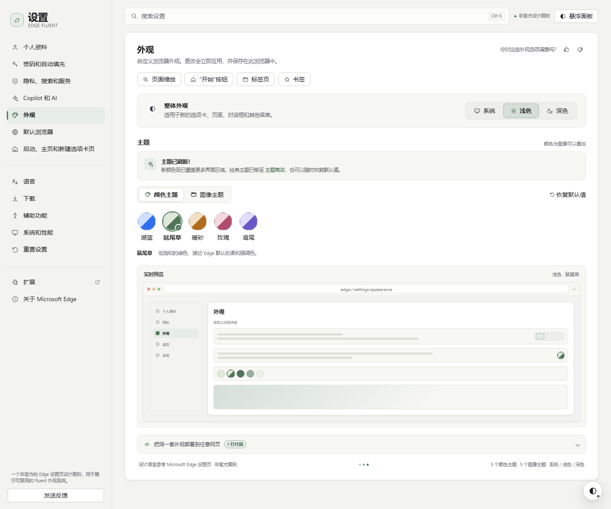
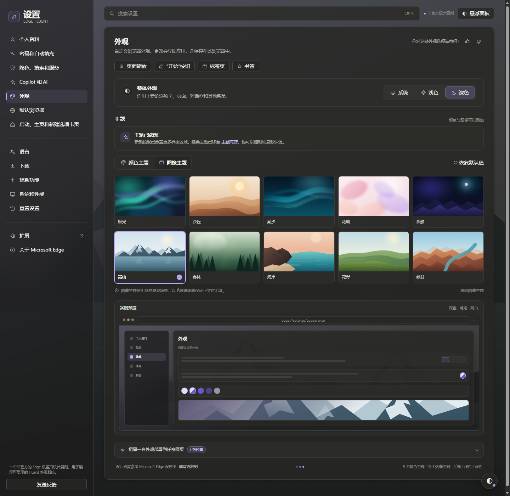
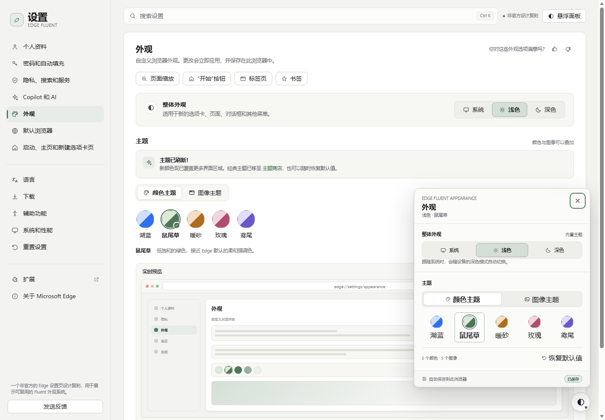
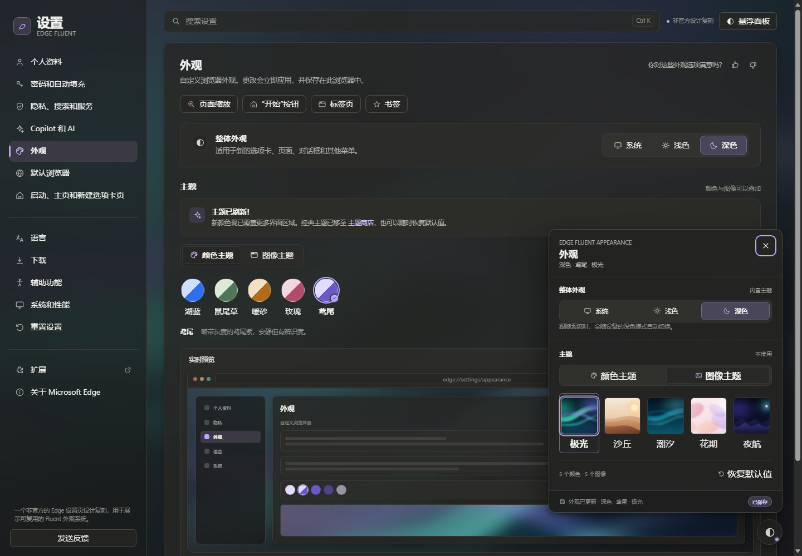
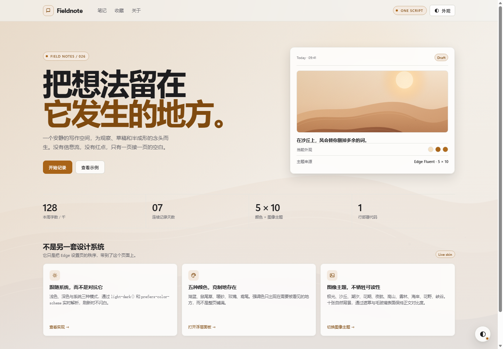
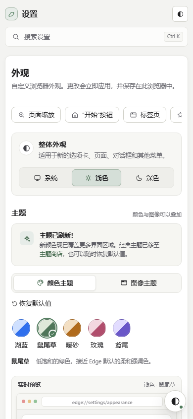

# Edge Fluent Appearance

[](LICENSE)
[](https://sherry-qiuu.github.io/edge-fluent-appearance/demo/)

> A distilled, drop-in implementation of the visual language behind the Microsoft Edge Settings page: warm neutral canvas, quiet sidebar, one large surface, compact Fluent controls, **3 appearance modes**, **5 color themes**, and **5 image themes**.
>
> This is an original, non-official design system. It ships no Microsoft logos or screenshots and is not affiliated with Microsoft.



**Live demo:** https://sherry-qiuu.github.io/edge-fluent-appearance/demo/
**Source:** https://github.com/Sherry-Qiuu/edge-fluent-appearance

## Why this exists

Most “Edge-style” recreations copy the screenshot and stop at a static mockup. This skill extracts the *grammar* — proportions, surface hierarchy, accent discipline, control density, and the separation between appearance and theme — and turns it into an asset you can deploy to any page with one script.

- **One file** (`assets/edge-theme.js`) contains the CSS, the five SVG art themes, the appearance resolver, and the floating panel.
- **Zero dependencies**, no build step, no font download, no external images.
- **Honest modes**: overlay-only for third-party pages, canvas for editorial pages, full kit for settings/app shells.
- **Accessible**: 4.5:1+ text, focus rings, keyboard panel, reduced motion, color-independent selection states.

## Preview

| Light — color theme | Dark — image theme + panel |
| --- | --- |
|  |  |

| Floating panel — color | Floating panel — image |
| --- | --- |
|  |  |





## Install as an agent skill

```bash
npx skills add Sherry-Qiuu/edge-fluent-appearance -g
```

Or download the repo and drop `assets/edge-theme.js` into any site.

## Use it

```html
<script src="/path/to/edge-theme.js"></script>
```

That is the whole integration. It adds the Edge canvas, the floating appearance panel, and this API:

```js
window.EdgeTheme.setAppearance("dark");   // system | light | dark
window.EdgeTheme.setColorTheme("iris");   // azure | sage | amber | rose | iris
window.EdgeTheme.setImageTheme("aurora"); // none | aurora | dune | tide | bloom | nocturne
window.EdgeTheme.reset();
```

Set defaults with data attributes:

```html
<script
  src="/path/to/edge-theme.js"
  data-edge-appearance="system"
  data-edge-color-theme="sage"
  data-edge-image-theme="dune"
  data-edge-panel="true"
  data-edge-skin="canvas"
></script>
```

For a third-party or legacy page that must not be repainted:

```html
<script src="/path/to/edge-theme.js" data-edge-skin="none" data-edge-panel="true"></script>
```

For strict CSP, link `assets/edge-theme.css` directly and set `data-edge-inject-css="false"`.

## The built-ins

**Appearance:** system · light · dark

**Color:** 湖蓝 Azure · 鼠尾草 Sage · 暖砂 Amber · 玫瑰 Rose · 鸢尾 Iris

**Image:** 极光 Aurora · 沙丘 Dune · 潮汐 Tide · 花期 Bloom · 夜航 Nocturne

Color and image themes can be layered. Image themes apply a scrim and 82% glass surfaces so the art never compromises body copy.

## Files

| Path | What it is |
| --- | --- |
| `SKILL.md` | The agent-facing skill: triggers, deployment depth, token mapping, API, QA checklist. |
| `assets/edge-theme.js` | Self-contained production bundle (107 KB raw, roughly 30 KB compressed). |
| `assets/edge-theme.css` | The same styles for manual/CSP-safe integration. |
| `assets/src/` | Tokens, components, panel, responsive layers, runtime source, and `build.mjs`. |
| `demo/index.html` | Full Edge-style settings page with live preview and deploy snippet. |
| `demo/any-page.html` | A normal content site wearing the skin with one script. |
| `references/design-spec.md` | The extracted measurements, tokens, states, and component anatomy. |
| `references/deployment.md` | Static/React/Vue/Next/CSP/iframe/WordPress recipes. |

## Open the demo

```bash
# from the skill folder
python -m http.server 8000
# http://localhost:8000/demo/
```

Or open `demo/index.html` directly. Some browsers restrict `localStorage` on `file://`; the runtime catches this and keeps the choice in memory.

Query overrides for screenshots:

```text
demo/index.html?appearance=dark&color=iris&image=aurora&tab=image
demo/index.html?appearance=light&panel=open
demo/any-page.html?appearance=dark&color=iris&image=nocturne
```

## Rebuild

Edit the CSS layers or runtime source, then:

```bash
node assets/src/build.mjs
```

The build inlines all five SVG themes into the CSS, embeds the CSS into the JS bundle, and fails if a theme reference is missing.

## Design notes

The visual rules are in [`references/design-spec.md`](references/design-spec.md). The short version:

- Warm `#f3f3f1` canvas, one white surface, 1 px borders, 2–8 px shadows.
- 264 px rail; 38 px nav rows; one accent-tinted active row.
- 32–40 px controls; 6–12 px radii; pills only for swatches and badges.
- One accent per view; accent-soft selection, accent-line border.
- 14 px body, 12.5 px descriptions, 10.5 px meta; Segoe UI stack.
- Image themes are scenes behind glass, never full-bleed wallpaper behind text.

## Contributing

Issues and pull requests are welcome. Keep the design-system rules intact: one accent per view, 1 px borders, 6–12 px radii, and honest light/dark contrast. If you change the CSS or runtime, rebuild before committing:

```bash
node assets/src/build.mjs
```

## License

MIT © 2026 Shihan QIU. See [LICENSE](LICENSE).

## Non-affiliation

Microsoft, Microsoft Edge, and the Edge logo are trademarks of Microsoft Corporation. This project is an independent design study. The interface copy in the demo is original; the wordmark is an abstract mark, not the Edge logo.
