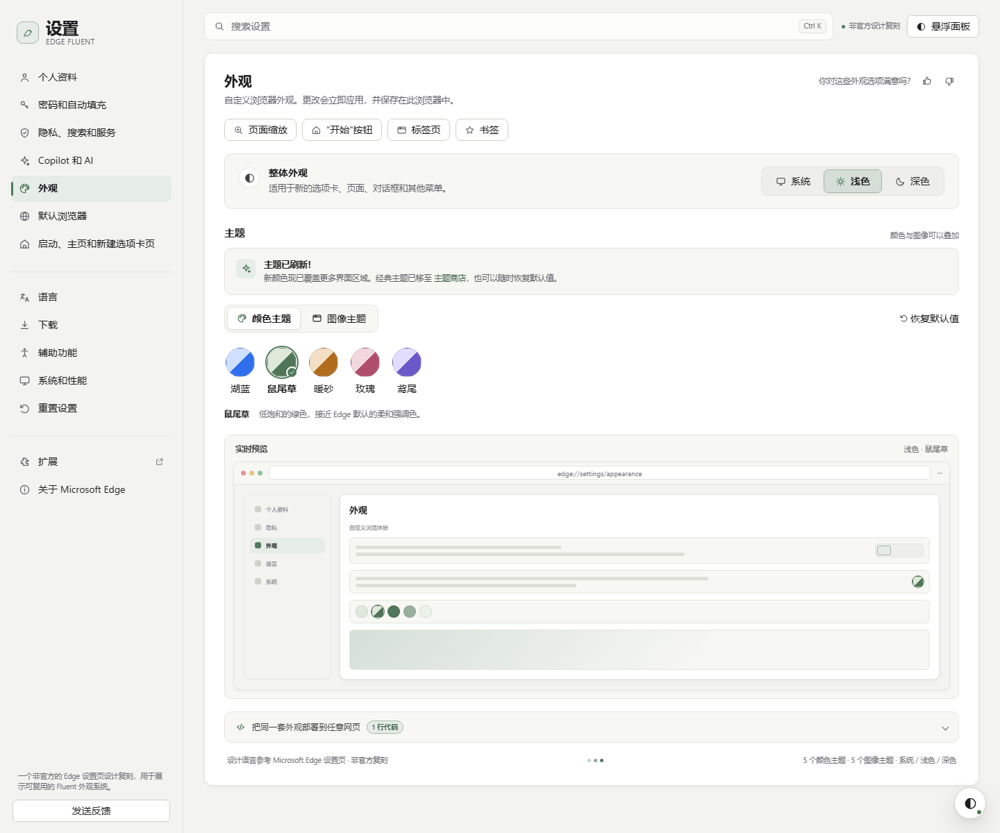

# Edge Fluent Appearance

A distilled, reusable implementation of the visual grammar behind the Microsoft Edge Settings page (2026): warm neutral canvas, a quiet sidebar, a single large surface, thin borders, compact 32–40 px controls, restrained sage/blue accents, and a clear separation between **appearance** and **theme**.

This is an original design system, not a pixel-for-pixel copy and not an official Microsoft asset. Microsoft, Edge, and the Edge logo are trademarks of Microsoft Corporation. Do not present the result as an official Microsoft product.

Canonical repository: https://github.com/Sherry-Qiuu/edge-fluent-appearance



## What is in the box

| Path | Purpose |
| --- | --- |
| `assets/edge-theme.js` | **One-script deployment.** Injects all CSS, resolves appearance, mounts the floating panel, exposes `window.EdgeTheme`. Self-contained (five SVG art themes embedded). |
| `assets/edge-theme.css` | The same design system as plain CSS for manual integration or strict CSP. |
| `assets/src/` | Maintainable source layers and the build script. Edit the source, then run `node assets/src/build.mjs`. |
| `demo/index.html` | Full Edge-style appearance page and live preview. |
| `demo/any-page.html` | A normal content site wearing the same skin with one script. |
| `references/design-spec.md` | Tokens, measurements, component anatomy, and the rules that make it feel like Edge. |
| `references/deployment.md` | Static, React, Vue, CSP, iframe, and no-JS recipes. |

## The 30-second deployment

Put the script in `<head>` before the page's own styles. This is important: the runtime sets the color scheme before first paint and injects the stylesheet immediately.

```html
<script src="/path/to/edge-theme.js"></script>
```

That single line gives the page:

- system / light / dark appearance, resolved live through `prefers-color-scheme`;
- five color themes: 湖蓝 Azure, 鼠尾草 Sage, 暖砂 Amber, 玫瑰 Rose, 鸢尾 Iris;
- five image themes: 极光 Aurora, 沙丘 Dune, 潮汐 Tide, 花期 Bloom, 夜航 Nocturne;
- a floating Edge-style appearance panel, persisted in `localStorage`;
- CSS custom properties for every surface, text, border, accent, and art layer.

Set author defaults with data attributes:

```html
<script
  src="/path/to/edge-theme.js"
  data-edge-appearance="system"
  data-edge-color-theme="sage"
  data-edge-image-theme="dune"
  data-edge-panel="true"
  data-edge-skin="canvas"
></script>
```

| Attribute | Values | Default | Notes |
| --- | --- | --- | --- |
| `data-edge-appearance` | `system` / `light` / `dark` | `system` | Initial value; the user's stored choice wins after the first visit. |
| `data-edge-color-theme` | `azure` / `sage` / `amber` / `rose` / `iris` | `sage` | Exactly five built-ins. |
| `data-edge-image-theme` | `none` / `aurora` / `dune` / `tide` / `bloom` / `nocturne` | `none` | `none` means color-only. |
| `data-edge-panel` | `true` / `false` | `true` | `false` removes the launcher and panel; controls/API still work. |
| `data-edge-launcher` | `true` / `false` | `true` | Hide only the floating button. |
| `data-edge-skin` | `canvas` / `none` | `canvas` | `canvas` paints the body background/art/type. `none` leaves the host page untouched. |
| `data-edge-position` | `bottom-right` / `bottom-left` | `bottom-right` | Avoids existing chat widgets. |
| `data-edge-persist` | `true` / `false` | `true` | Disable for demos and kiosks. |
| `data-edge-inject-css` | `true` / `false` | `true` | Set `false` when CSS is linked separately. |
| `data-edge-query` | `true` / `false` | `false` | Enables `?appearance=dark&color=iris&image=aurora&panel=open`. Only for preview links; query values override saved state. |
| `data-edge-lang` | `zh` / `en` | `zh` | Panel copy language. |
| `data-edge-storage-key` | any string | `edge-fluent-appearance:v1` | Use a unique key when embedding in a larger app. |

`data-edge-appearance` is also the switch that activates the canvas in CSS-only mode. Set `data-edge-skin="none"` to use the palette and panel without painting the host page. The runtime writes `data-edge-skin` itself, so the two paths behave the same.

## Choose the deployment depth

Do not promise a full dark-mode conversion when the host page hard-codes white cards. Pick the honest level:

### 1. Overlay only — `data-edge-skin="none"`

The panel and tokens work; the host page is untouched. Best for third-party or legacy pages where layout and contrast cannot be guaranteed. The page can opt in selectively:

```css
.my-card {
  background: var(--edge-surface);
  color: var(--edge-text);
  border: 1px solid var(--edge-border);
}
```

### 2. Canvas — `data-edge-skin="canvas"` (default)

Adds the Edge canvas, art backdrop, type family, selection, and scrollbars to `body`, plus the floating panel. Content that already uses transparent or token-based surfaces adapts immediately. This is the best default for editorial pages, landing pages, and dashboards with translucent cards.

### 3. Full kit — use `.edge-*` components

Use for a settings page or an app shell that should look like the reference. Start from `demo/index.html` and copy the shell: `.edge-app`, `.edge-sidebar`, `.edge-main`, `.edge-page`, `.edge-card`, `.edge-segmented`, `.edge-tabs`, `.edge-swatch-option`, `.edge-art-card`, `.edge-preview-card`.

For an existing React/Vue/Svelte app, keep the markup and map its classes to the tokens; see `references/deployment.md`.

## Agent playbook

Follow this order, and do not skip the contrast check.

1. **Audit the target.** Identify the root/body element, page background, main surfaces, text colors, borders, accent, existing theme system, and any white cards that would break in dark mode. Note whether the page is server-rendered.
2. **Choose depth.** `none` for zero-risk overlay, `canvas` for content pages, full kit for settings/app shells.
3. **Place the asset.** Copy `assets/edge-theme.js` into the site (or serve the folder). Add the script in `<head>` with the author defaults. Do not use `defer` for the theme script: the color scheme must be set before first paint.
4. **Set no-JS attributes.** Add `data-edge-appearance`, `data-edge-color-theme`, and `data-edge-image-theme` to `<html>` as well, so the correct palette paints even if the script is blocked.
5. **Map surfaces.** Replace hard-coded page/card/text/border colors with the token table below. Keep spacing and layout; the Edge character comes from proportion and restraint, not from rewriting layout.
6. **Verify.** Check light, dark, and system in both a light and a dark OS setting; all five colors; all five image themes; keyboard focus; 390 px mobile; contrast; no flash on reload; persisted choice.
7. **Remove the scaffolding.** Delete the floating panel for production if it is not a user-facing feature (`data-edge-panel="false"`), or keep it if the site is a design demo.

## Token map for mapping an existing page

| Host concern | Use | Why |
| --- | --- | --- |
| Page background | `--edge-bg` | Warm neutral, never pure gray or pure white. |
| Card / dialog | `--edge-surface` | White in light, charcoal in dark. |
| Secondary card / hover fill | `--edge-surface-2`, `--edge-surface-3` | 2–4% separation, not a new color. |
| Primary text | `--edge-text` | 15:1 contrast in both modes. |
| Secondary text | `--edge-text-2` | Labels and navigation. |
| Description / hint | `--edge-muted` | 5.7:1 light, 6.9:1 dark on surfaces. |
| Small meta | `--edge-faint` | 4.6:1 light, 4.8:1 dark; do not use below 10 px. |
| Border | `--edge-border`; stronger on controls: `--edge-border-strong` | 1 px only. |
| Selected / accent | `--edge-accent`, `--edge-accent-text`, `--edge-accent-soft` | Accent fill, readable accent text, tinted selected state. |
| Focus | `--edge-focus-ring` or `2px solid var(--edge-accent)` | Never remove focus. |
| Radius | `--edge-r-sm` 6, `--edge-r-md` 8, `--edge-r-lg` 10, `--edge-r-xl` 12 | Pills only for badges and swatches. |
| Motion | `--edge-ease`, `--edge-dur-1` 120 ms | Short, functional, no bounce. |
| Art | `--edge-art`, `--edge-art-scrim`, `--edge-art-tint` | Image theme plus readable scrim. |

## The design DNA in one screen

- **One canvas, one surface.** A warm `#f3f3f1` canvas; one large white surface; secondary cards are a barely darker neutral (`#f7f7f4`). Separation comes from 1 px borders and a 2–8 px shadow, not from many elevations.
- **Quiet navigation.** 264 px sidebar; 38 px rows; a single accent-tinted active row with a 3 px accent bar. No icons in colored boxes, no heavy hover.
- **Compact control rhythm.** 32–40 px controls, 8 px radius, 3 px padding inside segmented containers, 12.5–14 px labels. Desktop density, not marketing-page airiness.
- **One accent per view.** The accent appears on the active row, selected segment, active tab, focus ring, primary action, and theme swatch. It never fills a whole page.
- **Half-light / half-dark swatches.** Color themes are represented as a 42 px circle split on a 135° diagonal: the pale tint and the deep tone. The selected swatch gets a 2 px accent ring plus a small check badge.
- **Image themes are scenes, not textures.** 16:9 abstract landscapes; when active, surfaces become 82% opaque glass with a blur; the art is visible at the page margins and in previews, never behind body text without a scrim.
- **Edge-like copy.** Short labels, sentence-case descriptions, no exclamation marks except the one status notice, no emoji.
- **Motion.** 120–180 ms; panel enters with a 6–10 px rise; respect `prefers-reduced-motion`.

Full measurements and component anatomy: `references/design-spec.md`.

## Built-in catalog

### Color themes

| ID | Name | Character | Light accent | Dark accent |
| --- | --- | --- | --- | --- |
| `azure` | 湖蓝 Azure | The classic browser blue; clearest link/selection signal. | `#2f6fed` | `#8ab8ff` |
| `sage` | 鼠尾草 Sage | The reference screenshot's soft green; default. | `#4f7a5b` | `#a8c9a6` |
| `amber` | 暖砂 Amber | Warm, paper-like, low glare. | `#a96418` | `#e9b36a` |
| `rose` | 玫瑰 Rose | A restrained warm accent for neutral UIs. | `#b04d6c` | `#e8a4b8` |
| `iris` | 鸢尾 Iris | Muted violet; distinctive without shouting. | `#6a57c8` | `#b9a8ff` |

### Image themes

| ID | Name | Direction |
| --- | --- | --- |
| `aurora` | 极光 Aurora | Teal/violet ribbons over a deep night sky. |
| `dune` | 沙丘 Dune | Warm layered dunes and a low sun. |
| `tide` | 潮汐 Tide | Deep blue waves with cyan foam. |
| `bloom` | 花期 Bloom | Soft rose/lilac petals in blurred light. |
| `nocturne` | 夜航 Nocturne | Indigo ridges, stars, and a cold moon. |

## JavaScript API

```js
const theme = window.EdgeTheme;

theme.get();
// { appearance: "system", mode: "dark", colorTheme: "sage", imageTheme: "none", version: "1.0.0" }

theme.setAppearance("dark");       // "system" | "light" | "dark"
theme.setColorTheme("iris");       // the five IDs above
theme.setImageTheme("aurora");     // "none" or the five IDs
theme.set({ colorTheme: "rose", imageTheme: "dune" });
theme.reset();                     // back to author defaults, clears storage
theme.open();
theme.close();
theme.toggle();
```

Listen for changes (including OS theme changes while in system mode):

```js
window.addEventListener("edge-theme:change", (event) => {
  console.log(event.detail);
});
window.addEventListener("edge-theme:ready", () => {});
```

The runtime writes `data-edge-appearance`, `data-edge-mode`, `data-edge-color-theme`, and `data-edge-image-theme` on `<html>`. Use those attributes in your own CSS instead of duplicating state in JavaScript.

## Verification checklist

- [ ] Light and dark both pass 4.5:1 for body text, 3:1 for large text and control boundaries.
- [ ] System mode follows a live OS change without a reload.
- [ ] All five colors and all five image themes render; no missing art.
- [ ] Reload keeps the choice; reset returns to the author default.
- [ ] Panel opens by keyboard, traps Tab, closes on Escape, and returns focus.
- [ ] 390 px viewport has no horizontal page scroll; the quick-chip strip may scroll on its own.
- [ ] No flash of the wrong theme on first paint.
- [ ] Image themes keep body copy readable; cards are glass, not transparent.
- [ ] `prefers-reduced-motion` disables the entrance animation.
- [ ] No Microsoft logo, Edge wordmark, or copied screenshot is shipped as an asset.

## Do not

- Do not use a dark `filter: invert()` as a shortcut; it destroys brand images and produces muddy colors.
- Do not put the image art behind primary text without the scrim and a 82%+ opaque surface.
- Do not use 20 px+ radii for cards, or full pills for buttons; that reads as a different design language.
- Do not use more than one accent color in a view; image + color theme are the only layering allowed.
- Do not set text to pure black on pure white, or pure white on pure black; use the tokens.
- Do not copy the Edge logo or present the output as an official Microsoft product.

## Troubleshooting

| Symptom | Fix |
| --- | --- |
| Flash of light theme on a dark site | Move the script into `<head>` before any stylesheet; add the `data-edge-*` attributes to `<html>`. |
| Panel missing | `data-edge-panel="false"`, CSP blocking injected `<style>`, or the script loaded twice. Check the console. |
| CSP blocks the injected stylesheet | Link `edge-theme.css` manually, set `data-edge-inject-css="false"`, and pre-set the HTML attributes. |
| Existing cards stay white in dark mode | The host hard-codes colors; map surfaces to `--edge-surface` / `--edge-text`, or use overlay-only mode. |
| Art is invisible | The host page has an opaque body background; use `canvas` mode or apply `--edge-art` to the page shell. |
| Panel hidden behind a chat widget | `data-edge-position="bottom-left"` or raise the site's widget. |
| `localStorage` unavailable | Private mode/file:// can block it; the runtime catches this and keeps the in-memory choice. |

## Reference files

- `references/design-spec.md` — the extracted measurements, tokens, states, and component anatomy.
- `references/deployment.md` — static/React/Vue/CSP/iframe recipes and production hardening.
